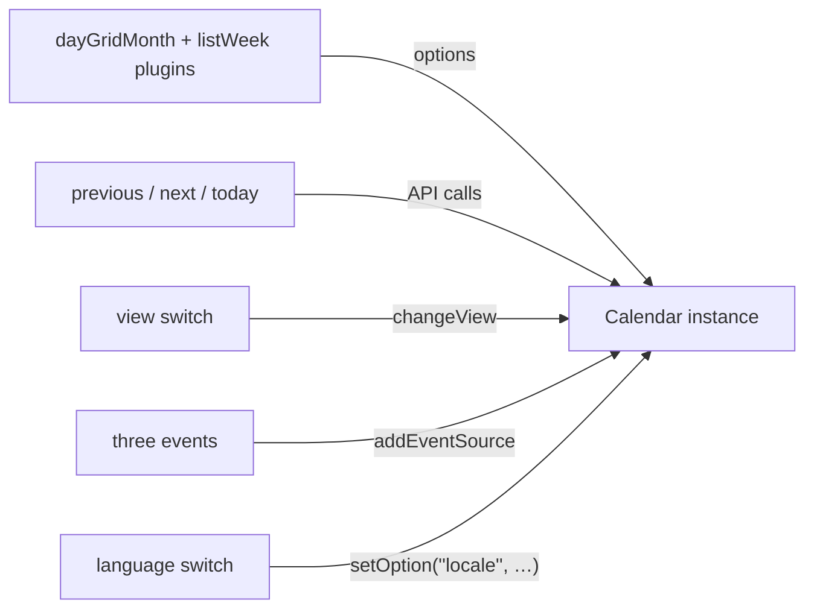

# Demo

The demo lives at [https://shijianjs.github.io/ktjs-fullcalendar/demo/](https://shijianjs.github.io/ktjs-fullcalendar/demo/).

The demo page mounts the real FullCalendar 7 widget through the wrapper: a day grid month view with
the interaction and list plugins loaded, three events added through the API, and buttons for
previous, next, today plus a view switch between `dayGridMonth` and `listWeek`. The language switch
changes the page text and calls `setOption("locale", …)` so the calendar's own labels follow too.

The language button in the page header switches between English and Simplified Chinese: every
visible string changes, not just the title.

The API reference is at [https://shijianjs.github.io/ktjs-fullcalendar/api/](https://shijianjs.github.io/ktjs-fullcalendar/api/), generated by Dokka from the published modules.
