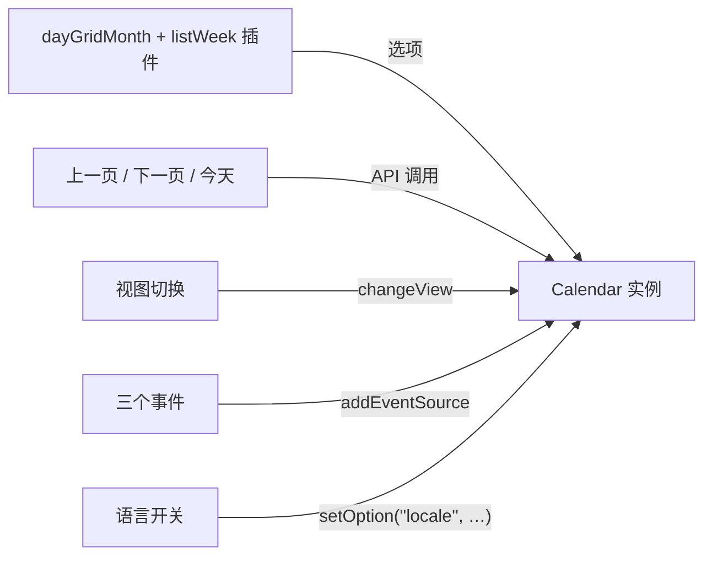

# 演示页

演示页：[https://shijianjs.github.io/ktjs-fullcalendar/demo/](https://shijianjs.github.io/ktjs-fullcalendar/demo/)

演示页用 wrapper 挂载真实的 FullCalendar 7 组件：day grid 月视图，加载 interaction 与 list 插件，
通过 API 添加三个事件，并提供上一页、下一页、今天以及 `dayGridMonth` / `listWeek` 视图切换按钮。
语言开关会同时切换页面文案并调用 `setOption("locale", …)`，让日历自身的标签也跟着变。

页面右上角的语言按钮在英文与简体中文之间切换，切换的是页面上全部可见文案（不只是页面标题）。

API 文档在 [https://shijianjs.github.io/ktjs-fullcalendar/api/](https://shijianjs.github.io/ktjs-fullcalendar/api/)，由 Dokka 从已发布模块生成。
