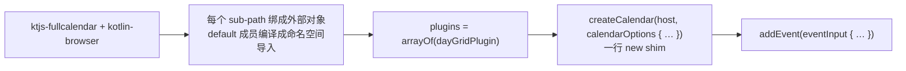

# 快速开始

## 依赖

```kotlin
kotlin {
    js {
        binaries.executable()
        browser()
    }
    sourceSets {
        jsMain.dependencies {
            implementation("io.github.shijianjs:ktjs-fullcalendar:7.1.5-kt.1")
            // `kotlin-browser` 的 `web.*` 类型出现在公开 API 里，所以消费方要能编译到它们。
            implementation("org.jetbrains.kotlin-wrappers:kotlin-browser:2026.11.1")
        }
    }
}
```

要求 Kotlin 2.4.21 或更新版本；wrapper 输出 ESM，`es2015` 目标起可用。

## 注册插件

FullCalendar 7 通过**插件值**注册视图：每个子路径在 default export 上导出一个插件。wrapper 把它们暴露成普通的 Kotlin 属性，因此注册就是把它们放进 `plugins`：

```kotlin
import io.github.shijianjs.ktjs.fullcalendar.dayGridPlugin
import io.github.shijianjs.ktjs.fullcalendar.interactionPlugin

calendarOptions {
    plugins = arrayOf(dayGridPlugin, interactionPlugin)
}
```

Kotlin/JS 会把 `@JsModule` + `@JsName` 声明编译成**默认导入**，所以每个子路径都绑定成 external object，其 `default` 成员被编译成命名空间导入 —— 这是没有具名导出的包唯一可行的写法。



## 第一个调用

```kotlin
import io.github.shijianjs.ktjs.fullcalendar.createCalendar
import io.github.shijianjs.ktjs.fullcalendar.core.DateInput
import io.github.shijianjs.ktjs.fullcalendar.core.calendarOptions
import io.github.shijianjs.ktjs.fullcalendar.core.eventInput
import io.github.shijianjs.ktjs.fullcalendar.dayGridPlugin

fun mountCalendar(host: web.html.HTMLElement) {
    val calendar = createCalendar(
        host,
        calendarOptions {
            plugins = arrayOf(dayGridPlugin)
            initialView = "dayGridMonth"
            initialDate = DateInput("2026-11-16")
            locale = "zh-cn"
        },
    )
    calendar.addEvent(
        eventInput {
            id = "release"
            title = "Wrapper release"
            start = DateInput("2026-11-16")
        },
        null,
    )
}
```

`Calendar` 是模块命名空间里的值而不是 `external` 构造器，所以实例通过
`createCalendar(host, options)` 创建 —— wrapper 内部用一行 `new` shim 实现。

## 构建与测试

```bash
./gradlew build                     # 编译、Detekt、浏览器测试
./gradlew :ktjs-fullcalendar:jsBrowserTest     # 只跑 wrapper 的浏览器测试
./gradlew :docs:docusaurusStart     # 文档开发服务器
./gradlew pagesSite                 # 文档在 /，演示在 /demo/，Dokka 在 /api/
```
