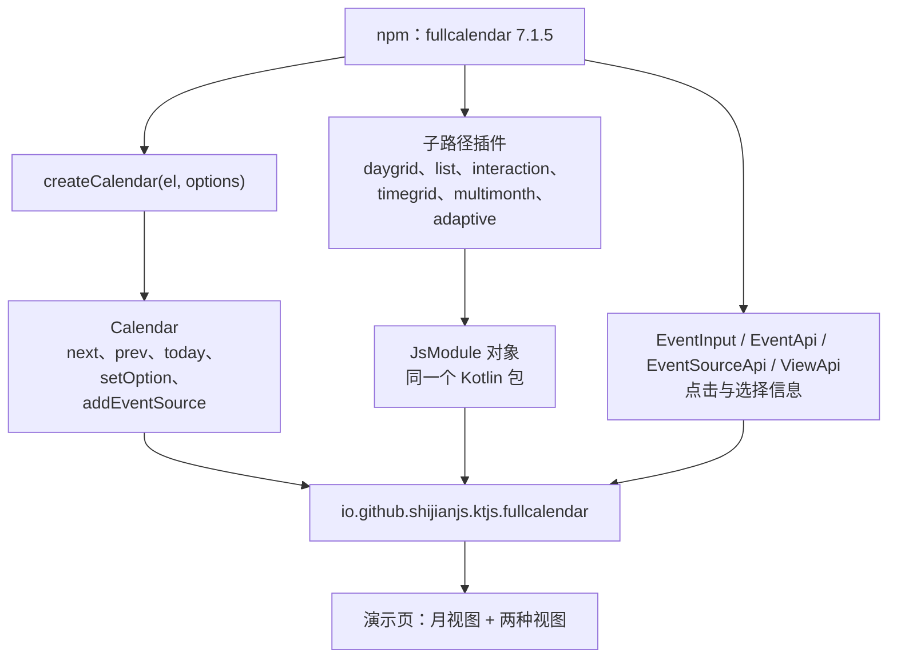

# 简介

`ktjs-fullcalendar` 是 [FullCalendar](https://github.com/fullcalendar/fullcalendar) 生态里 `fullcalendar` 7.1.5 的 Kotlin/JS wrapper：上游
`.d.ts` 里的每个类型和成员都落成可被编译器检查的 `external` 声明，不靠 `dynamic` 兜底。

封装范围是 `fullcalendar` 7 的 vanilla 日历：围绕 `Calendar` 类的 `createCalendar()`、带类型的 `CalendarOptions` 构造器、`EventInput` / `EventApi` / `EventSourceApi` / `ViewApi` 句柄、点击与选择的信息对象，以及以 `fullcalendar/daygrid`、`timegrid`、`multimonth`、`list`、`interaction`、`all` 发布的六个视图插件。

## 封装了哪些包

| 模块 | Gradle 坐标 | 上游 |
| --- | --- | --- |
| `ktjs-fullcalendar` | `io.github.shijianjs:ktjs-fullcalendar` | `fullcalendar` 7.1.5（单个 npm 包，多个子路径入口） |

上游是 npm 包 monorepo；这里只封装已发布的 `fullcalendar` 入口，所有子路径（`fullcalendar/daygrid` 等）都以 `JsModule` 对象的形式落在同一个 Kotlin 包里。

日历是一个对象加一份选项：wrapper 要做的是让每个选项名、每个事件字段都是类型化成员，而不是字符串键。

## 许可证

wrapper 自身是 MIT。上游 `fullcalendar` 的许可证与 wrapper 不同，商用前请读
[许可证说明](guide/license.md)。

## 接下来

- [快速开始](guide/getting-started.md) — 加依赖、写第一个调用、跑构建。
- [API 概览](guide/api-overview.md) — 包结构、类型映射约定、常用写法。
- [演示页](guide/demo.md) — 浏览器里直接看效果。
